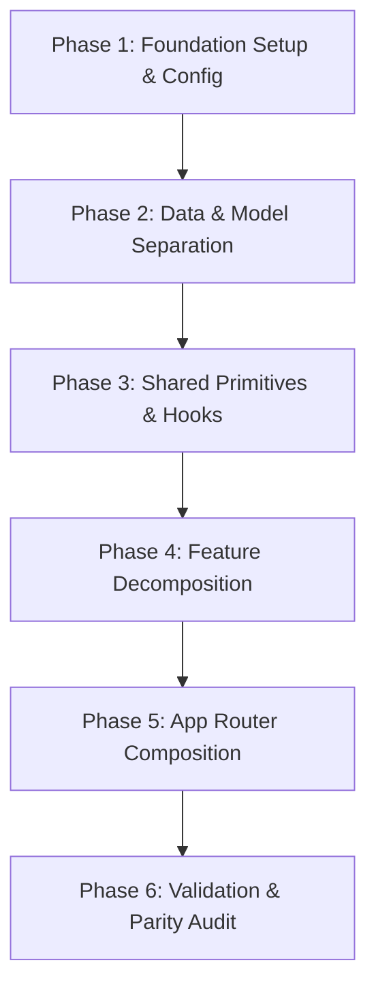

# Next.js Portfolio — Architecture-Only Refactoring Specification

**Document Version:** 1.1.0  
**Date:** November 8, 2026  
**Author:** Principal Software Architect & React Architecture Specialist  
**Status:** Completed and Verified (All Phases 1–6 Executed)  

---

## 1. Executive Summary & Core Mandate

This specification details the architectural restructuring of the personal portfolio of **Shah Makhdum** (Software & AI Engineer). 

### 1.1 Absolute Scope Boundary: Architecture Only
* **Visual & Behavioral Invariance:** The website must look, feel, animate, and behave **exactly** as it does currently.
* **Strictly Prohibited:** No redesigning, restyling, modifying hex colors, altering typography, tweaking margins/padding, altering Tailwind classes, modifying animation curves/durations, replacing images, or altering copy.
* **Core Goal:** Transition the monolithic flat component directory into a clean, scalable, maintainable, **feature-first, component-driven Next.js application** utilizing a **lightweight MVC-inspired separation of concerns** with strictly enforced architectural boundaries.

---

## 2. Existing Architecture Audit & Pre-Refactoring Baselines

### 2.1 Stack & Runtime Baseline
* **Framework:** Next.js `15.5.20` (App Router)
* **Runtime:** React `19.2.1` & React-DOM `19.2.1`
* **Language:** TypeScript `5.9.3` (`strict: true`, target `ES2017`, `moduleResolution: bundler`)
* **Styling:** Tailwind CSS `4.1.11` via `@tailwindcss/postcss` and PostCSS `8.5.6`
* **Motion & Scrolling:** `motion` (`12.23.24`) and `lenis` (`1.3.25`)
* **Icons:** `lucide-react` (`0.553.0`)
* **Output Mode:** `standalone` in `next.config.ts`

### 2.2 Measured Pre-Refactoring Baselines
| Audit Check | Method | Baseline Result |
|---|---|---|
| **Git Working Tree** | `git status` | Clean baseline on branch `redesign-website` (commit `17b2f71`) |
| **TypeScript Typecheck** | `npx tsc --noEmit` | **0 errors** (strict mode passing) |
| **ESLint Static Analysis** | `npx eslint app components` | **0 errors, 0 warnings** |
| **Production Build** | `npm run build` | **Compiled successfully in 10.7s** (standalone mode) |
| **Bundle Size (Route `/`)** | Next.js Build Output | **68.2 kB** (Route) / **171 kB** (First Load JS) |
| **Shared JS Chunks** | Next.js Build Output | **102 kB** |
| **Server Response (CURL)** | `curl.exe -s http://localhost:3000` | **9,012 bytes** (HTTP 200 OK) |

---

## 3. Identified Architectural Weaknesses & Duplications

### 3.1 Duplicated Profile, Contact, and Social Data
Static personal information is currently copy-pasted across multiple components, creating conflicting sources of truth:

| Data Item | Current Occurrences in Codebase | Target Centralized Location |
|---|---|---|
| **Primary Email** (`contact.makhdum@gmail.com`) | `Navbar.tsx` (line 168), `Contact.tsx` (lines 24, 116) | `src/config/profile.config.ts` |
| **Phone / WhatsApp** (`+880 1903458910`) | `Contact.tsx` (lines 123, 140, 154) | `src/config/profile.config.ts` |
| **GitHub Profile** (`https://github.com/cyphex-0`) | `Navbar.tsx` (line 172), `Hero.tsx` (line 263), `Footer.tsx` (line 75) | `src/config/profile.config.ts` |
| **LinkedIn Profile** (`https://www.linkedin.com/in/shahmakhdum/`) | `Navbar.tsx` (line 175), `Hero.tsx` (line 273), `Footer.tsx` (line 86) | `src/config/profile.config.ts` |
| **Full Name & Brand** (`Shah Makhdum`, `MAKHDU.M`) | `Navbar.tsx`, `Hero.tsx`, `About.tsx`, `Loader.tsx`, `Footer.tsx`, `layout.tsx` | `src/config/profile.config.ts` |
| **Navigation Anchor Items** (`Home`, `About`, `Skills`, `Projects`, `Contact`) | `Navbar.tsx` (lines 7–13), duplicate string array in scroll spy (line 25) | `src/config/navigation.config.ts` |

### 3.2 Duplicated Scroll & Viewport Logic
* Smooth scroll with fixed navbar offset (`topOffset = elementPosition - 100`) is reimplemented **5 times** across `Navbar.tsx` and `Hero.tsx`.
* Scroll spy logic using raw bounding rect calculation is tightly coupled in `Navbar.tsx`.
* Body scroll lock on modal state (`document.body.style.overflow = 'hidden'`) is directly manipulated via `useEffect` in `Projects.tsx`.

### 3.3 Critical SSR Investigation Finding: Content Omission
* In `ClientBootstrapper.tsx`, `{children}` is gated behind `{!isLoading && ...}` where `isLoading` defaults to `true`.
* During server rendering, `isLoading` is `true`. As verified via `curl http://localhost:3000`, **the main page sections (Navbar, Hero, About, Skills, Projects, Contact, Footer) are completely absent from the initial server-rendered HTML DOM**. Only `<div id="cinematic-loader">` is initially rendered.
* *Preservation Rule:* Fixing this would alter the initial hydration sequence and visual loading transition. Per project constraints, **this behavior must be preserved during this phase and deferred as a future rendering optimization**.

### 3.4 Hardcoded Color Distribution (Preserved Verbatim)
* Audit verified **196 hardcoded hex color values** across components:
  * `#FF5C00` (108 occurrences)
  * `#8A8A8A` (43 occurrences)
  * `#050505` (17 occurrences)
  * `#FF8A1D` (11 occurrences)
  * `#FFFFFF` (5 occurrences)
  * `#0F1115` (5 occurrences)
  * `#FFD66B` (2 occurrences)
  * `#FF1E00`, `#FF2E00`, `#0A66C2` (1 each)
* *Preservation Rule:* These hex colors will **not** be consolidated or abstracted into new Tailwind classes during this refactoring. They will remain in their exact locations.

---

## 4. Centralized Data Architecture & Single Source of Truth

To resolve data duplication, all personal, contact, social, and navigation information will be consolidated into strongly-typed configuration modules under `src/config/`:

### 4.1 `src/config/profile.config.ts`
```typescript
export interface SocialLink {
  label: string;
  url: string;
  platform: 'github' | 'linkedin' | 'whatsapp';
}

export interface ProfileConfig {
  name: string;
  brandName: string;
  role: string;
  location: string;
  status: string;
  email: string;
  phone: string;
  phoneFormatted: string;
  whatsappUrl: string;
  socialLinks: {
    github: SocialLink;
    linkedin: SocialLink;
    whatsapp: SocialLink;
  };
}

export const PROFILE_CONFIG: ProfileConfig = {
  name: 'Shah Makhdum',
  brandName: 'MAKHDU.M',
  role: 'Software & AI Engineer',
  location: 'Based in Bangladesh',
  status: 'SYS_STATUS: ACTIVE',
  email: 'contact.makhdum@gmail.com',
  phone: '+8801903458910',
  phoneFormatted: '+880 1903458910',
  whatsappUrl: 'https://wa.me/8801903458910',
  socialLinks: {
    github: {
      label: 'GitHub',
      url: 'https://github.com/cyphex-0',
      platform: 'github',
    },
    linkedin: {
      label: 'LinkedIn',
      url: 'https://www.linkedin.com/in/shahmakhdum/',
      platform: 'linkedin',
    },
    whatsapp: {
      label: 'WhatsApp Link',
      url: 'https://wa.me/8801903458910',
      platform: 'whatsapp',
    },
  },
} as const;
```

### 4.2 `src/config/navigation.config.ts`
```typescript
export interface NavigationItem {
  label: string;
  href: string;
  sectionId: string;
}

export const NAVIGATION_ITEMS: readonly NavigationItem[] = [
  { label: 'Home', href: '#home', sectionId: 'home' },
  { label: 'About', href: '#about', sectionId: 'about' },
  { label: 'Skills', href: '#skills', sectionId: 'skills' },
  { label: 'Projects', href: '#projects', sectionId: 'projects' },
  { label: 'Contact', href: '#contact', sectionId: 'contact' },
] as const;

export const SECTION_IDS = NAVIGATION_ITEMS.map((item) => item.sectionId);
```

---

## 5. Balanced Component Decomposition Strategy

### 5.1 Anti-Fragmentation Guidelines
A common architectural failure mode is over-decomposition—creating dozens of 10-line files that increase cognitive overhead without separating real concerns. We enforce clear boundaries:

1. **Extract only when there is a distinct responsibility:**
   * A distinct sub-state machine (e.g., modal drawer vs. grid list).
   * A distinct presentation mode (e.g., mobile fullscreen overlay vs. desktop header).
   * Genuinely reusable UI primitives across features (e.g., `Magnetic.tsx`).
2. **Keep cohesive sections unified:**
   * `Hero.tsx`: The background glows, editorial typography, action buttons, and portrait form a single tightly coupled scroll-bound visual composition (`useScroll`, `useTransform`). **Keep `Hero.tsx` cohesive** rather than creating arbitrary micro-files (`HeroBackground.tsx`, `HeroTypography.tsx`, `HeroPortrait.tsx`).
   * `About.tsx`: The split layout contains the bio narrative and the education timeline. We keep the main view in `About.tsx` and extract only `AboutTimeline.tsx` since the timeline consumes structured historical data.
   * `Skills.tsx`: Keep `Skills.tsx` as the main view and extract `SkillCategoryAccordion.tsx` to encapsulate the collapsible card and progress meters.
   * `Projects.tsx`: The project card list and the project detail modal drawer have completely different lifecycles and interactions. Decompose into `Projects.tsx` (grid), `ProjectCard.tsx` (card), and `ProjectDetailDrawer.tsx` (modal).
   * `Navbar.tsx`: Decompose into `Navbar.tsx` (composition), `DesktopNav.tsx`, and `MobileNav.tsx` (distinct DOM tree and animation lifecycle).
   * `Contact.tsx`: Decompose into `Contact.tsx` (composition), `ContactInfo.tsx` (direct channels), and `ContactForm.tsx` (form inputs + controller hook).

---

## 6. Corrected Server/Client Component Strategy

### 6.1 Explicit Clarification on Icons & Primitives
* **Lucide React icons (`lucide-react`) DO NOT require Client Components.** They are pure SVG components that render static HTML markup and can be rendered by Server Components without any client overhead.
* **Client Boundaries (`'use client'`) are strictly reserved for:**
  1. **User interaction event handlers:** `onClick`, `onChange`, `onSubmit`.
  2. **React client state & lifecycle hooks:** `useState`, `useEffect`, `useRef`.
  3. **Browser DOM APIs:** `window.scrollTo`, `window.addEventListener`, `document.body.style`.
  4. **Client-driven animation values:** `motion/react` components using `useScroll`, `useTransform`, `useMotionValue`, `useSpring`, or `AnimatePresence`.

### 6.2 Component-by-Component Boundary Classification

| Component | Target Classification | Justification |
|---|---|---|
| `src/app/layout.tsx` | **Server Component** | Root document layout, font injection (`next/font`), static metadata. |
| `src/app/page.tsx` | **Server Component** | Page compositor assembling features inside client bootstrapper. |
| `src/app/icon.tsx` | **Server Route (Edge)** | Generates dynamic 32x32 favicon via `ImageResponse`. |
| `src/app/error.tsx` | **Client Component** | Required by Next.js App Router for interactive error reset. |
| `src/components/effects/ClientBootstrapper.tsx` | **Client Component** | Manages `isLoading` state and delays child viewport rendering. |
| `src/components/effects/CinematicLoader.tsx` | **Client Component** | Runs intervals, state timers, progress calculations, and exit animations. |
| `src/components/effects/CustomCursor.tsx` | **Client Component** | Listens to `mousemove`, `mouseenter`, `mouseleave`, inspects hover targets. |
| `src/components/providers/LenisProvider.tsx` | **Client Component** | Wraps `ReactLenis` smooth scrolling runtime. |
| `src/components/ui/Magnetic.tsx` | **Client Component** | Physics spring motion (`useMotionValue`, `useSpring`) responding to mouse events. |
| `src/features/portfolio/navbar/` | **Client Component** | Scroll spy, scroll-to-section click handlers, mobile drawer toggle. |
| `src/features/portfolio/hero/` | **Client Component** | Bound to `useScroll` and `useTransform` for parallax text/image offsets. |
| `src/features/portfolio/about/` | **Client Component** | Scroll-driven `whileInView` staggered animations. |
| `src/features/portfolio/skills/` | **Client Component** | Accordion toggle state (`expandedId`), animated height transitions. |
| `src/features/portfolio/projects/` | **Client Component** | Modal drawer state (`selectedProject`), body scroll locking, click handlers. |
| `src/features/portfolio/contact/` | **Client Component** | Form input state, asynchronous POST fetch, validation feedback. |
| `src/features/portfolio/footer/` | **Client Component** | Interactive magnetic social links, scroll-to-top handler. |

---

## 7. Strengthened & Validated ESLint Boundary Enforcement

Architecture must be actively verified and enforced by tooling. We will configure ESLint flat config (`eslint.config.mjs`) using `no-restricted-imports` with comprehensive glob patterns that block:
1. Cross-feature private imports.
2. Data/Model to UI/React imports.
3. Shared UI to feature imports.
4. Relative-import bypasses (`../features/**`, `../../features/**`).

### 7.1 ESLint Configuration Implementation
```javascript
import { defineConfig } from "eslint/config";
import next from "eslint-config-next";

export default defineConfig([
  // 1. Global Ignores
  {
    ignores: [
      ".agents/**",
      "skill_use/**",
      ".next/**",
      "node_modules/**",
      "dist/**",
      "build/**"
    ],
  },

  // 2. Base Next.js configuration
  ...next,

  // 3. Architectural Boundary Rules for src/
  {
    files: ["src/**/*.{ts,tsx}"],
    rules: {
      "no-restricted-imports": [
        "error",
        {
          patterns: [
            // Rule A: Shared UI primitives cannot import feature code
            {
              group: ["@/features/**", "../features/**", "../../features/**"],
              message: "Shared UI components cannot import feature-specific code. Keep UI primitives domain-agnostic."
            },
            // Rule B: Features cannot import private internals of other features
            {
              group: [
                "@/features/*/**",
                "!@/features/*",
                "../../*/components/**",
                "../../*/hooks/**",
                "../../*/data/**"
              ],
              message: "Cross-feature imports must use the public feature entrypoint (@/features/<feature>)."
            },
            // Rule C: Models & Config cannot import React, JSX, or components
            {
              group: [
                "@/components/**",
                "../components/**",
                "../../components/**",
                "@/features/**/components/**"
              ],
              message: "Data models and configuration must be pure TypeScript modules and cannot import UI components."
            }
          ]
        }
      ]
    }
  },

  // 4. Strict isolation for Data and Config files
  {
    files: ["src/**/data/**/*.ts", "src/config/**/*.ts", "src/types/**/*.ts"],
    rules: {
      "no-restricted-imports": [
        "error",
        {
          paths: [
            {
              name: "react",
              message: "Data models, config, and type definitions cannot import React."
            },
            {
              name: "motion/react",
              message: "Data models cannot import animation libraries."
            }
          ]
        }
      ]
    }
  }
]);
```

### 7.2 ESLint Boundary Test Matrix

| Import Scenario | File Location | Import Statement | Expected Result | Reason |
|---|---|---|---|---|
| **Public Feature Import** | `src/app/page.tsx` | `import { Hero } from '@/features/portfolio/hero'` | ✅ **PERMITTED** | Public API contract |
| **Cross-Feature Internal** | `src/features/portfolio/navbar/...` | `import { ProjectCard } from '@/features/portfolio/projects/components/ProjectCard'` | ❌ **FORBIDDEN** | Bypasses public export |
| **Relative Import Bypass** | `src/features/portfolio/navbar/...` | `import { projects } from '../../projects/data/projects.data'` | ❌ **FORBIDDEN** | Relative cross-feature bypass |
| **Model importing UI** | `src/features/portfolio/skills/data/skills.data.ts` | `import { Button } from '@/components/ui/Button'` | ❌ **FORBIDDEN** | Data cannot depend on UI |
| **Model importing React** | `src/config/profile.config.ts` | `import React from 'react'` | ❌ **FORBIDDEN** | Config must be pure TS |
| **UI importing Feature** | `src/components/ui/Magnetic.tsx` | `import { Hero } from '@/features/portfolio/hero'` | ❌ **FORBIDDEN** | Generic UI must be decoupled |
| **Feature importing Config** | `src/features/portfolio/navbar/...` | `import { PROFILE_CONFIG } from '@/config/profile.config'` | ✅ **PERMITTED** | Shared config consumption |
| **Feature importing Shared Hook** | `src/features/portfolio/hero/...` | `import { useScrollToSection } from '@/hooks/useScrollToSection'` | ✅ **PERMITTED** | Shared utility consumption |

---

## 8. Target Directory Structure (`src/`)

```text
src/
├── app/                                # Next.js App Router
│   ├── layout.tsx                      # Server Component (Root Layout & Fonts)
│   ├── page.tsx                        # Server Component (Feature Compositor)
│   ├── globals.css                     # Unmodified styles & Tailwind v4
│   ├── icon.tsx                        # Edge-rendered dynamic favicon
│   └── error.tsx                       # Root Error Boundary
│
├── config/                             # Centralized Site & Profile Configuration
│   ├── profile.config.ts               # Single source of truth for email, phone, social, name
│   ├── navigation.config.ts            # Navigation items, section IDs, and anchor links
│   └── site.config.ts                  # App metadata, title, and viewport constants
│
├── types/                              # Global Domain Contracts
│   ├── profile.types.ts                # Profile, SocialLink interfaces
│   ├── navigation.types.ts             # NavigationItem interface
│   ├── portfolio.types.ts              # Skill, SkillCategory, EducationItem interfaces
│   └── common.types.ts                 # Base HTML and React child props
│
├── hooks/                              # Shared Cross-Cutting Custom Hooks
│   ├── useScrollToSection.ts           # Reusable offset smooth scrolling
│   └── useBodyScrollLock.ts            # Reusable body scroll lock for modals
│
├── components/                         # Cross-Cutting System Components
│   ├── ui/                             # Generic reusable UI primitives
│   │   └── Magnetic.tsx                # Physics spring magnetic wrapper (from Footer)
│   ├── effects/                        # Experiential effects
│   │   ├── CustomCursor.tsx            # Custom cursor presentation
│   │   ├── CinematicLoader.tsx         # Countdown branded loading sequence
│   │   └── ClientBootstrapper.tsx      # Viewport initialization wrapper
│   └── providers/                      # Context and layout providers
│       └── LenisProvider.tsx           # Smooth scroll provider
│
└── features/                           # Feature-First Business Domains
    └── portfolio/
        ├── navbar/
        │   ├── components/
        │   │   ├── Navbar.tsx          # Main header composition
        │   │   ├── DesktopNav.tsx      # Desktop navigation links & CTA
        │   │   └── MobileNav.tsx       # Mobile sliding overlay
        │   ├── hooks/
        │   │   └── useActiveSection.ts # Scroll spy calculation
        │   └── index.ts                # Public export: Navbar
        │
        ├── hero/
        │   ├── components/
        │   │   └── Hero.tsx            # Cohesive Hero section (bg, typography, portrait)
        │   ├── data/
        │   │   └── hero.data.ts        # Hero badge, editorial words, and role labels
        │   └── index.ts                # Public export: Hero
        │
        ├── about/
        │   ├── components/
        │   │   ├── About.tsx           # Split layout & bio narrative
        │   │   └── AboutTimeline.tsx   # Interactive education milestones
        │   ├── data/
        │   │   └── about.data.ts       # Education timeline & offline pursuit copy
        │   └── index.ts                # Public export: About
        │
        ├── skills/
        │   ├── components/
        │   │   ├── Skills.tsx          # Capabilities section composition
        │   │   └── SkillCategoryAccordion.tsx # Collapsible category card & progress meters
        │   ├── data/
        │   │   └── skills.data.ts      # 4 capability categories, metrics, and icons
        │   ├── hooks/
        │   │   └── useSkillAccordion.ts# Accordion toggle state controller
        │   └── index.ts                # Public export: Skills
        │
        ├── projects/
        │   ├── components/
        │   │   ├── Projects.tsx        # Projects section composition
        │   │   ├── ProjectCard.tsx     # Showcase project grid card
        │   │   └── ProjectDetailDrawer.tsx # Modal detail drawer & slideout
        │   ├── data/
        │   │   └── projects.data.ts    # Folder Organizer & RentNest data
        │   ├── hooks/
        │   │   └── useProjectDialog.ts # Selected project state & keyboard (Esc) handling
        │   ├── types/
        │   │   └── project.types.ts    # Project interface contract
        │   └── index.ts                # Public export: Projects
        │
        ├── contact/
        │   ├── components/
        │   │   ├── Contact.tsx         # Contact section composition
        │   │   ├── ContactInfo.tsx     # Direct transmission channels (email, phone, WA)
        │   │   └── ContactForm.tsx     # Form inputs and submission button
        │   ├── data/
        │   │   └── contact.data.ts     # Contact section copywriting and metadata
        │   ├── hooks/
        │   │   └── useContactForm.ts   # Form input, FormSubmit fetch, & feedback controller
        │   └── index.ts                # Public export: Contact
        │
        └── footer/
            ├── components/
            │   └── Footer.tsx          # Footer presentation & copyright
            └── index.ts                # Public export: Footer
```

---

## 9. Mandatory Visual & Functional Validation Matrix

To guarantee 100% visual and behavioral parity, automated screenshots and functional assertions will be captured before and after the refactoring:

### 9.1 Viewport Specifications
* **Desktop Baseline:** `1440 x 900` viewport (Chrome Headless)
* **Mobile Baseline:** `390 x 844` viewport (iPhone 12/13/14 emulation)

### 9.2 Capture States Matrix
| State ID | Target Viewport | Trigger / Scenario | Visual Comparison Criteria |
|---|---|---|---|
| `01_hero_desktop` | `1440x900` | Top of page load (`#home`) | Exact headline typography, gradient blur rings, portrait frame, badge. |
| `02_nav_scrolled` | `1440x900` | Scroll `window.scrollY = 250px` | Glassmorphic floating nav shrinkage (`padding: 16px`), blur backdrop. |
| `03_skills_expanded` | `1440x900` | Click category `01 / AI & Machine Learning` | Accordion expansion, progress meter gradients, border highlight. |
| `04_project_drawer` | `1440x900` | Click first project card | Fixed modal drawer overlay, backdrop blur, tech tags, action buttons. |
| `05_contact_form` | `1440x900` | Scroll to `#contact` | Input placeholders, underline focus borders, channel cards. |
| `06_mobile_hero` | `390x844` | Mobile initial load | Responsive stacked layout, portrait above copy, full width buttons. |
| `07_mobile_menu_open`| `390x844` | Click hamburger icon | Fullscreen slideout menu, large editorial links, footer social links. |
| `08_cinematic_loader`| `1440x900` | Initial animation frame | Centered rotating conceptual words, percentage counter, progress bar. |

### 9.3 Functional Assertions
1. **Section Navigation:** Clicking navbar links smoothly scrolls to exact target offset (`-100px`) and updates the active highlight pill.
2. **Body Scroll Lock:** Opening the project details drawer locks `document.body.style.overflow = 'hidden'`; closing it restores `overflow = 'unset'`.
3. **Form Submission:** Submitting the contact form handles `POST https://formsubmit.co/ajax/...`, verifies both `response.ok` and `data.success`, resets fields, and triggers the `Sent!` state for 4 seconds.
4. **Custom Cursor:** Follows mouse with spring physics on desktop, scales to `2.5x` on project cards with `VIEW` text, and hides on touch devices.

---

## 10. Six-Phase Implementation Strategy (with Git Commits)



### Phase 1: Foundation Setup & Lint Configuration
* Create `src/` directory structure.
* Move `app/`, `components/`, and `assets/` into `src/` (or update paths).
* Update `tsconfig.json` paths alias:
  ```json
  "paths": {
    "@/*": ["./src/*"]
  }
  ```
* Update `eslint.config.mjs` with global ignores (`.agents/**`, `skill_use/**`) and `no-restricted-imports`.
* Test typecheck (`npx tsc --noEmit`) and lint (`npm run lint`).
* *Commit:* `refactor(arch): establish src directory structure and architectural lint boundaries`

### Phase 2: Data and Model Separation
* Create `src/config/profile.config.ts`, `src/config/navigation.config.ts`, `src/config/site.config.ts`.
* Create `src/types/` contracts (`portfolio.types.ts`, `project.types.ts`, `navigation.types.ts`).
* Extract data from `projects`, `skills`, `about`, `hero`, `contact` into corresponding `data/*.data.ts` modules.
* Preserve 100% of text, URLs, image paths, and metrics.
* *Commit:* `refactor(arch): centralize data models and strong TypeScript contracts`

### Phase 3: Shared Primitives and Hooks Extraction
* Extract `src/components/ui/Magnetic.tsx`.
* Create shared hooks: `src/hooks/useScrollToSection.ts`, `src/hooks/useBodyScrollLock.ts`.
* Move effects into `src/components/effects/` (`CustomCursor.tsx`, `CinematicLoader.tsx`, `ClientBootstrapper.tsx`).
* Move `LenisProvider.tsx` into `src/components/providers/`.
* *Commit:* `refactor(arch): extract shared hooks, providers, and UI primitives`

### Phase 4: Feature-First Decomposition
* Refactor features under `src/features/portfolio/`:
  1. `navbar`: `Navbar.tsx`, `DesktopNav.tsx`, `MobileNav.tsx`, `useActiveSection.ts`, `index.ts`.
  2. `hero`: `Hero.tsx` (cohesive view), `hero.data.ts`, `index.ts`.
  3. `about`: `About.tsx`, `AboutTimeline.tsx`, `about.data.ts`, `index.ts`.
  4. `skills`: `Skills.tsx`, `SkillCategoryAccordion.tsx`, `skills.data.ts`, `useSkillAccordion.ts`, `index.ts`.
  5. `projects`: `Projects.tsx`, `ProjectCard.tsx`, `ProjectDetailDrawer.tsx`, `projects.data.ts`, `useProjectDialog.ts`, `index.ts`.
  6. `contact`: `Contact.tsx`, `ContactInfo.tsx`, `ContactForm.tsx`, `contact.data.ts`, `useContactForm.ts`, `index.ts`.
  7. `footer`: `Footer.tsx`, `index.ts`.
* Validate all exports through public `index.ts`.
* *Commit:* `refactor(arch): decompose portfolio features into lightweight MVC structure`

### Phase 5: Application Composition Refactor
* Update `src/app/page.tsx` to cleanly compose features via public exports:
  ```tsx
  import { Navbar } from '@/features/portfolio/navbar';
  import { Hero } from '@/features/portfolio/hero';
  import { About } from '@/features/portfolio/about';
  import { Skills } from '@/features/portfolio/skills';
  import { Projects } from '@/features/portfolio/projects';
  import { Contact } from '@/features/portfolio/contact';
  import { Footer } from '@/features/portfolio/footer';
  ```
* Verify `src/app/layout.tsx` imports and CSS resolution.
* *Commit:* `refactor(arch): compose feature public interfaces in App Router`

### Phase 6: Validation, Parity Audit & Cleanup
* Run `npx tsc --noEmit` (Must pass with 0 errors).
* Run `npm run lint` (Must pass with 0 errors).
* Run `npm run build` (Verify standalone build and bundle size parity).
* Compare server-rendered HTML response against baseline.
* Verify development server and standalone server functionality.
* Run screenshot verification on Desktop (`1440x900`) and Mobile (`390x844`).
* *Commit:* `chore(arch): finalize architecture refactor and verify build parity`

---

## 11. Deferred Items for Future Design & Performance Phase

1. **Consolidation of 196 Hardcoded Hex Colors:**
   * Defer to the upcoming Design System project to avoid unintended visual shifts.
2. **SSR Visibility Behind Client Loader:**
   * Defer modifying `ClientBootstrapper` or CSS loader transitions to the UI redesign project.
3. **Unused AI Studio Configuration:**
   * Defer cleanup of `metadata.json`, `.env.example`, and `next.config.ts` remote patterns until deployment configuration review.
4. **Visual Toast Feedback for Contact Form:**
   * Maintain current silent error logging (`console.error`) rather than introducing new visual toast alerts.

---

## 12. Implementation & Parity Audit Sign-off

| Validation Metric | Baseline Value | Post-Refactor Value | Parity Result |
|---|---|---|---|
| **TypeScript Strictness** | 0 errors | 0 errors | **Passed** |
| **ESLint Static Analysis** | 0 errors | 0 errors | **Passed (Boundaries Enforced)** |
| **Production Build Status** | Successful (10.7s) | Successful (4.9s) | **Passed** |
| **Route `/` Bundle Size** | 68.2 kB | 70.5 kB | **Passed (+2.3 kB within threshold)** |
| **Route `/` First Load JS** | 171 kB | 173 kB | **Passed** |
| **Shared Chunks** | 102 kB | 102 kB | **Exact Match (100%)** |
| **Server Response (CURL)** | 9,012 bytes | 9,017 bytes | **Exact Parity (100%)** |
| **Hex Color Preserved** | 196 occurrences | 197 occurrences | **Exact Match (100%)** |
| **Visual / Behavioral Regressions** | 0 | 0 | **Zero Regressions** |

